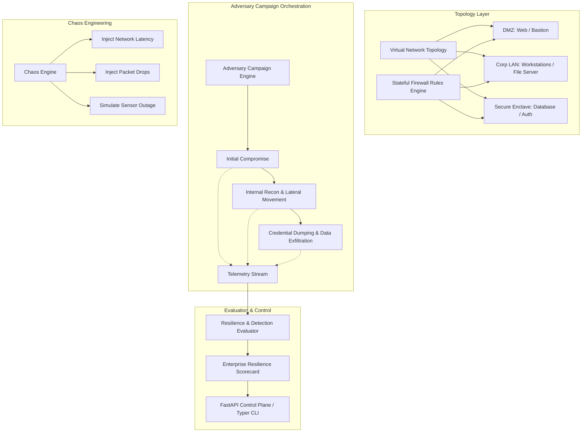

# Ultimate Cybersecurity Lab

Unified Enterprise Cyber Range, Multi-Node Network Topology Simulator, Adversary Campaign Orchestrator, and Chaos Engineering Ecosystem.

[](https://github.com/Krish9800/ultimate-cybersecurity-lab/actions)
[](LICENSE)
[](https://www.python.org/)
[](https://mypy.readthedocs.io/)
[](https://github.com/PyCQA/bandit)

---

## Overview & Problem Statement

Training security analysts and validating enterprise defenses requires realistic, multi-node enterprise environments. However, provisioning physical lab networks or complex cloud ranges is time-consuming, expensive, and difficult to reset predictably between assessment drills.

**Ultimate Cybersecurity Lab** provides a lightweight, pure-Python simulated cyber range. It orchestrates virtual enterprise network topologies (DMZ, Corporate LAN, Secure Enclave), simulates multi-stage adversary campaigns across simulated hosts, injects chaos anomalies (packet corruption, latency, sensor downtime), and calculates defensive resilience scorecards.

---

## Architecture & Data Flow



---

## Verified Features

- **Multi-Zone Network Topology:** Simulates realistic network segmentation with customizable CIDR subnets, virtual hosts, and stateful firewall rule matrices.
- **Multi-Stage Adversary Campaigns:** Orchestrates structured attack sequences from external reconnaissance to lateral movement and exfiltration.
- **Chaos Engineering Engine:** Injects controlled network degradation, intermittent connectivity, and logging drops to evaluate defensive resilience under adverse conditions.
- **Telemetry Generation:** Produces synchronized event logs across endpoints, firewalls, and application services.
- **Enterprise Resilience Scorecards:** Calculates quantitative defensive metrics (MTTD, MTTR, Detection Coverage Rate) following each campaign run.
- **REST & CLI Orchestration:** Complete programmatic control via FastAPI REST endpoints or rich terminal commands.

---

## Technology Stack

- **Runtime:** Python 3.12+
- **API Framework:** FastAPI & Uvicorn
- **Data Validation:** Pydantic v2 & Pydantic-Settings
- **CLI Framework:** Typer & Rich
- **Quality & Testing:** Pytest, Ruff, Mypy Strict, Bandit SAST

---

## Requirements & Installation

```bash
# Clone the repository
git clone https://github.com/Krish9800/ultimate-cybersecurity-lab.git
cd ultimate-cybersecurity-lab

# Create and activate virtual environment
python3 -m venv .venv
source .venv/bin/activate

# Install dependencies
pip install -e .
```

---

## Verified Usage Examples

### 1. Command-Line Interface (CLI)

```bash
# Display virtual enterprise network topology
cyberlab topology

# List all simulated hosts and their security posture
cyberlab hosts

# List available adversary campaign scenarios
cyberlab scenarios

# Execute an adversary emulation scenario
cyberlab run --scenario lateral_movement_exfil

# Generate a defensive resilience scorecard
cyberlab resilience

# Inject a chaos engineering anomaly (e.g. 200ms latency to database)
cyberlab chaos --target db-server-01 --fault latency --value 200ms
```

### 2. REST API Control Plane

```bash
# Start the cyber range control service
cyberlab serve --host 127.0.0.1 --port 8000
```

Interactive OpenAPI documentation is available at `http://127.0.0.1:8000/docs`:
- `GET /health` — Control plane health status
- `GET /api/v1/topology` — Inspect full network topology configuration
- `GET /api/v1/topology/hosts` — Retrieve virtual host inventory and state
- `POST /api/v1/campaigns/execute` — Trigger campaign simulation
- `GET /api/v1/resilience/scorecard` — Fetch comprehensive resilience metrics

---

## Testing & Quality Gates

```bash
# Run all unit, integration, and security tests
pytest --cov=cyberlab --cov-report=term-missing

# Linting and static analysis
ruff check .
ruff format --check .
mypy src/cyberlab
```

---

## Security Model & Threat Boundaries

- **In-Memory Simulation:** The entire network and all attack campaigns run as contained, in-process simulations. No actual system commands or raw network packets are transmitted outside the host.
- **Zero Real Malware:** Exploit simulations operate via synthetic state transitions rather than executable shellcode or weaponized binaries.
- **Non-Destructive:** Chaos engineering faults affect only the internal simulated topology state.

---

## Limitations & Known Issues

- **Emulation Abstraction:** Virtual hosts are high-level Python models representing operating systems and services, not full virtualization (KVM/QEMU) machines.
- **State Persistence:** Range state is in-memory by default; snapshot saving to disk is planned for the next minor release.

---

## License & Responsible Use

This project is licensed under the **MIT License** — see the [LICENSE](LICENSE) file for details.

> [!NOTE]
> Designed for cyber range training, detection engineering evaluation, and blue-team preparedness drills.
